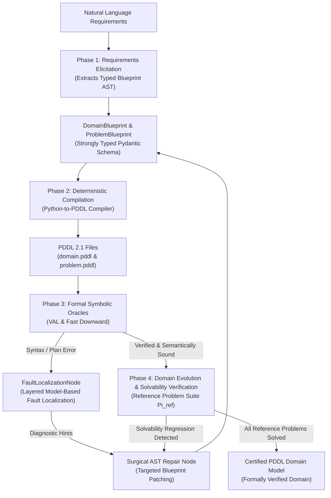
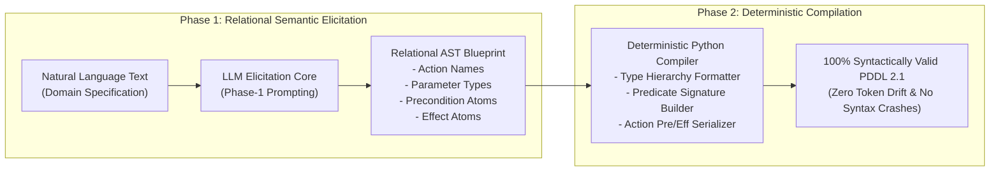
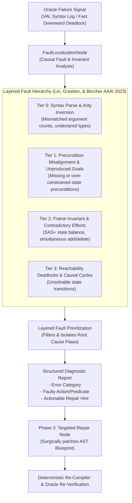
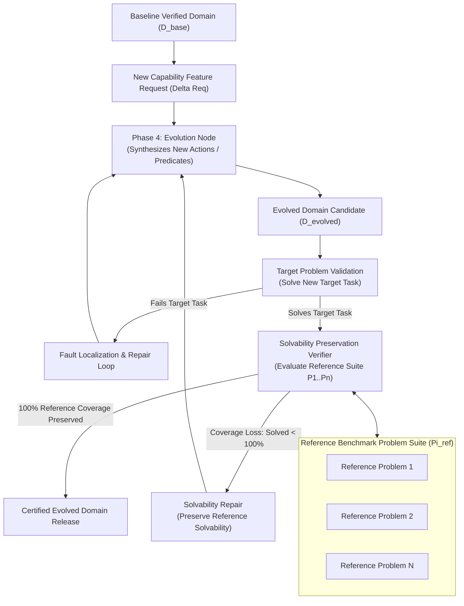

# Towards an Autonomous Lifecycle Agent for PDDL Domain Modelling

> **Master's Thesis Project**  
> **Author**: Roshan Gupta  
> **Supervisor**: Prof. Dr. Ilche Georgievski  
> **Institution**: Institute of Architecture of Application Systems (IAAS), University of Stuttgart  
> **License**: MIT  

---

## 📌 Project Overview

Constructing robust, error-free **PDDL (Planning Domain Definition Language)** domain models for classical automated planning is a complex, iterative knowledge engineering process. Conventional approaches treat PDDL creation as an isolated, single-shot natural language translation task, which frequently leads to token-level syntax crashes, predicate arity mismatches, and unreachable state deadlocks.

This project implements an **Autonomous Closed-Loop Lifecycle Agent** for classical planning (strictly pure **PDDL 2.1** with `:strips` and `:typing`). Rather than emitting raw text directly from unconstrained stochastic prompts, the agent orchestrates the complete PDDL domain engineering lifecycle (Knowledge Engineering for Planning and Scheduling - KEPS):

1. **Phase 1: Requirements Elicitation** — Extracts relational semantics from natural language specifications into a strongly typed Pydantic intermediate representation (`DomainBlueprint` and `ProblemBlueprint`).
2. **Phase 2: Deterministic Compilation** — Compiles the validated Abstract Syntax Tree (AST) schema into 100% syntactically valid PDDL 2.1 code via a deterministic Python compiler, eliminating token-level syntax malformations.
3. **Phase 3: Symbolic Verification, Layered Model-Based Fault Localization & Repair** — Couples formal symbolic oracles (**VAL** for syntax and plan execution validation, and **Fast Downward** for state reachability) with Deterministic Causal Fault Analysis & SAS+ Invariant Analysis to localize, categorize, and surgically repair domain bugs.
4. **Phase 4: Continuous Domain Evolution & Solvability Preservation Verification** — Extends existing domain capabilities with new action schemas and predicates while verifying reachability across a reference benchmark problem suite to prevent solvability regressions on canonical problem instances.

---

## 🏗️ System Architecture & Phase Mechanism Diagrams

### 1. Overall End-to-End Autonomous Lifecycle Architecture

The agent functions as a closed-loop state machine powered by LangGraph, coordinating elicitation, deterministic compilation, oracle verification, layered model-based fault localization, surgical repair, and solvability preservation verification.



---

### 2. Phase 1 & 2 Mechanism: Decoupled Elicitation & Deterministic AST Compilation

By separating semantic reasoning from concrete PDDL syntax generation, the system ensures that large language models reason exclusively over relational structures, while a deterministic compiler handles exact syntax, parentheses, and typing formatting.



---

### 3. Phase 3 Mechanism: Layered Model-Based Fault Localization & Closed-Loop Repair

When formal symbolic oracles detect a failure, the FaultLocalizationNode categorizes the fault into a structured hierarchy, prioritizes root causes via Layered Model-Based Fault Localization, and provides actionable repair hints to the AST repair engine.



---

### 4. Phase 4 Mechanism: Continuous Domain Evolution & Solvability Preservation Verification

When extending domain capabilities (e.g., adding actions to satisfy new planning requirements), the agent preserves reachability by validating candidate domains against a suite of canonical reference problem instances.



---

## 🔬 2x2 Factorial Experimental Ablation Matrix

To isolate the individual contributions of deterministic compilation (AST) and Layered Model-Based Fault Localization, the framework evaluates four distinct agent architectures across identical benchmark tasks:

| Agent Architecture | Representation Mode | Error Feedback Mode | Iterative Repair | Solvability Preservation Verifier | Primary Research Question |
| :--- | :--- | :--- | :--- | :--- | :--- |
| **UNSTRUCTURED_RETRY** | Direct PDDL Text | Raw Oracle Terminal Logs | Enabled (Iterative) | Disabled | Empirical prompt retry baseline |
| **ABLATION_NO_AST** | Direct PDDL Text | Structured Fault Localization Reports | Enabled (Iterative) | Disabled | Tests H1 (Impact of AST Compilation) |
| **ABLATION_NO_TRIAGE** | JSON AST Blueprint | Raw Oracle Terminal Logs | Enabled (Iterative) | Disabled | Tests H2 (Impact of Layered Fault Localization) |
| **CLOSED_LOOP_AST_AGENT** | JSON AST Blueprint | Structured Fault Localization Reports | Enabled (Iterative) | Enabled | Full Proposed System (H1, H2, H3) |

---

## 🧬 Synthetic Fault Taxonomy (Category B Flaw Benchmark)

Faults injected into Category B benchmark domains are systematically classified into five classical planning defect categories:

| Flaw Category Code | Category Identifier | Formal Description & Planning Semantics |
| :--- | :--- | :--- |
| **Flaw 1** | `TYPE_SIGNATURE_ARITY_INVERSION` | Parameter arity omissions, undeclared variables, or signature overloading violating first-order typing. |
| **Flaw 2** | `PRECONDITION_MISALIGNMENT` | Missing, over-constrained, or inverted precondition clauses blocking causal action enablement. |
| **Flaw 3** | `ACTION_EFFECT_DELETION` | Omission of necessary positive state transitions (add-effects) or resource releases (delete-effects). |
| **Flaw 4** | `INITIAL_GOAL_DEADLOCK` | Contradictory mutex conditions between initial state facts and goal specifications rendering the task unsolvable. |
| **Flaw 5** | `STATE_REACHABILITY_COLLAPSE` | Over-constrained action schemas that truncate forward reachability, inducing infinite heuristic search dead-ends. |

*(Note: Flaw 5 specifically tests single-domain state reachability repair, whereas Phase 4 tests multi-problem backward compatibility across an evolving problem suite.)*

---

## 📚 Canonical Benchmark Domains (24 Classical Pure STRIPS Domains)

The benchmark suite (`PDDLLifeCycleBench/`) includes 24 classical pure STRIPS (`:strips :typing`) planning domains drawn from the International Planning Competitions (IPC). Each domain folder contains:
- `domain_encoding.txt`: Isolated natural language domain capabilities and action rules.
- `domain.pddl`: The gold-standard reference domain model ($D_{gold}$).
- `orig_problems/`: Canonical problem instances ($P_1, P_2, \dots, P_{20}$).
- `flaws/`: The 5 synthetic defect instances (`flaw_01` to `flaw_05`), each with `domain_flawed.pddl` and `flaw_metadata.json`.
- `evolution/`: Incremental capability extension tasks for Phase 4.

| # | Domain Identifier | Origin | Problem Topology & Physical Dynamics |
| :---: | :--- | :--- | :--- |
| 1 | `barman14-bfs` | IPC 2014 | Robotic bartending: cocktail mixing, shaker manipulation, and discrete glass cleanliness states. |
| 2 | `blocksworld` | Classical | Block manipulation: stacking, unstacking, table placement, and single-gripper holding. |
| 3 | `childsnack14` | IPC 2014 | Meal preparation: sandwich making and serving under dietary and gluten-free allergic constraints. |
| 4 | `depot` | IPC 2002 | Multi-modal logistics: combines Blocksworld pallet stacking with inter-depot truck transport. |
| 5 | `driverlog02-bfs` | IPC 2002 | Multi-agent logistics: drivers walk, board trucks, navigate road networks, and load packages. |
| 6 | `elevators08` | IPC 2008 | Vertical passenger transport: fast express elevators and slow local elevators with floor capacities. |
| 7 | `ferry` | Classical | Vehicle transport: rolling freight transport between island harbors with single-car deck capacity. |
| 8 | `floortile` | IPC 2011 | Multi-robot grid painting: robots paint geometric patterns without stepping on wet tiles. |
| 9 | `goldminer` | IPC 2011 | Subterranean excavation: robotic rock mining, laser clearing, and key-gated vault access. |
| 10 | `grid` | IPC 1998 | Grid navigation: key collection, lock unlocking, and pathfinding in 2D cell environments. |
| 11 | `gripper` | Classical | Two-gripper robotic transport: transferring balls between rooms using left and right grippers. |
| 12 | `hiking14` | IPC 2014 | Trail hiking logistics: coordinating hikers, vehicles, and tent setup across consecutive trail nodes. |
| 13 | `logistics` | IPC 1998/2000 | Freight delivery: intra-city truck delivery and inter-city airplane transport through airports. |
| 14 | `movie98` | IPC 1998 | Entertainment preparation: linear ordering of tape rewinding, snack fetching, and projector setup. |
| 15 | `mprime98` | IPC 1998 | Resource-bounded logistics: vehicle transport governed by fuel, capacity tokens, and space. |
| 16 | `mystery98` | IPC 1998 | Graph routing: freight transport across topological graphs with strict fuel preservation constraints. |
| 17 | `parking11` | IPC 2011 | Vehicle maneuvering: rear-parking cars in tight, single-lane curb slots with blocking constraints. |
| 18 | `pegsol08` | IPC 2008 | Solitaire puzzle: jumping pegs over adjacent pieces into empty holes to minimize remaining pegs. |
| 19 | `pipesworld-notankage04-bfs` | IPC 2004 | Pipeline routing: batch fluid transmission through coupled pipe segments without surge tankage. |
| 20 | `rovers` | IPC 2002 | Planetary exploration: sample soil/rock collection, camera imaging, and transmission to lander. |
| 21 | `satellite` | IPC 2002 | Satellite observation: camera calibration, attitude turning, and spectral imaging across bands. |
| 22 | `scanalyzer08` | IPC 2008 | Automated greenhouse: plant inspection using rotating conveyor carousels and scan cycles. |
| 23 | `visitall` | IPC 2011 | Graph exploration: single-agent navigation required to visit all vertices of a grid graph. |
| 24 | `zenotravel02` | IPC 2002 | Aviation logistics: aircraft passenger transport with discrete fuel consumption and supersonic zoom. |

---

## 📊 Comprehensive Experimental Evaluation Metrics

All experiments record formal quantitative metrics grounded in symbolic oracles (VAL and Fast Downward) and bipartite graph matching:

| Metric Name | Formal Definition / Operational Rule | Operational Purpose |
| :--- | :--- | :--- |
| **Executability (Self-Consistency)** | `VAL(D_gen, P_gen, pi_gen) == SUCCESS` | Verifies that the synthesized or repaired domain model is internally solvable and causal actions do not violate state preconditions or effect invariants. |
| **Feasibility (Forward Soundness)** | `VAL(D_gold, P_gold, pi_gen) == SUCCESS` | Verifies plan transfer soundness; prevents model trivialization by ensuring synthesized actions obey physical ground-truth domain dynamics. |
| **Interpretability (Inverse Completeness)** | `VAL(D_gen, P_gold, pi_gold) == SUCCESS` | Verifies expressive completeness; ensures the synthesized domain can execute canonical human/expert reference plans without over-constrained preconditions. |
| **Reference Solvability Preservation (SPR / Cov_ref)** | Fraction of benchmark reference instances $\Pi_{ref}$ that remain solvable under $D_{evolved}$. | Ensures domain extensions or evolution updates do not cause backward-compatibility reachability loss on legacy canonical problem instances. |
| **Fault Localization Accuracy (FLA)** | Boolean flag indicating whether the FaultLocalizationNode correctly identified the target faulty element. | Measures fault localization precision against the ground-truth faulty action or predicate. |
| **Macro Structural F1 (ARE)** | Mean of operator F1 scores aligned via Kuhn-Munkres maximum bipartite matching against $D_{gold}$. | Measures action reconstruction accuracy without penalizing synonymous action naming. |
| **STRIPS Component F1** | F1 computed independently for Preconditions, Add Effects, and Delete Effects. | Isolates exact causal failure locations (missing preconditions vs. contradictory delete effects). |
| **Repair Iterations (k)** | Integer repair cycles required to reach formal validity: $k \in \{1, 2, \dots, N_{max}\}$. | Measures closed-loop repair efficiency and the effectiveness of fault localization feedback. |
| **Execution Latency & Cost** | Elapsed wall-clock time (seconds); LLM token cost computed via standard API telemetry. | Measures computational overhead, inference latency, and operational token cost. |

---

## 🏷️ Standardized Behavioral Outcome Classification

Beyond binary pass/fail indicators, every experiment instance is automatically classified into a standardized 7-tier behavioral outcome code:

* **A.1: First-Attempt Direct Success** — Target plan valid on initial compilation ($k = 1$), passing Executability, Feasibility, and Interpretability.
* **A.2: Refined Success via Feedback Loops** — Repaired successfully after 1 or more fault localization cycles ($k > 1$), achieving full tri-criteria verification.
* **B: Unparseable PDDL Syntax Failure** — Emitted model rejected by VAL syntax parser (token errors, unclosed parentheses).
* **C: Syntactically Valid but Planner Deadlock** — Valid syntax, but Fast Downward proves goal state is unreachable (missing causal producer).
* **D: Plan Generated but Fails Executability Self-Certification** — Planner output violates action preconditions or effect consistency on the generated domain.
* **E.1: Plan Feasibility Rejection on Standard Domain** — Generated plan fails execution transfer on gold-standard reference domain (physical unsoundness).
* **E.2: Standard Plan Interpretability Rejection on Generated Domain** — Gold reference plan fails execution on the generated domain (over-constrained preconditions / incompleteness).
* **F: Iteration Budget Exhausted (Oscillation)** — Agent reaches maximum iteration limit without convergence.

---

## 📂 Repository Directory Structure

```text
pddl_lifecycle_agent/
├── app.py                             # Interactive Streamlit visual application
├── graph.py                           # LangGraph state machine orchestrating closed-loop execution
├── run_repair_benchmark.py            # Category B Synthetic Fault Repair benchmark runner
├── run_evolution_benchmark.py         # Phase 4 Continuous Domain Evolution & Regression benchmark
├── run_synthesis_benchmark.py         # Phase 1 & 2 Greenfield Natural Language Synthesis benchmark
├── run_full_ipc_benchmark.py          # Master benchmark runner across canonical IPC domains
├── requirements.txt                   # Python package dependencies
├── .env.example                       # Example environment file for API keys and oracle paths
│
├── nodes/                             # Implementation of the 5 KEPS lifecycle nodes
│   ├── elicitation.py                 # Phase 1: Natural language extraction into AST blueprints
│   ├── generation.py                  # Phase 2: Deterministic Python-to-PDDL compiler
│   ├── fault_localization.py          # Phase 3.1: Layered model-based fault localization & prioritization
│   ├── repair.py                      # Phase 3.2: Targeted, surgical AST blueprint repair
│   ├── evolution.py                   # Phase 4.1: Action model delta synthesis for new capabilities
│   └── maintenance.py                 # Phase 4.2: Solvability preservation verification suite
│
├── schemas/                           # Strongly typed Pydantic intermediate representations
│   └── pddl_blueprint.py              # DomainBlueprint and ProblemBlueprint schemas
│
├── config/                            # Standards and execution configurations
│   ├── model_config.py                # Strict phase-to-model LLM mapping (temperature = 0.0)
│   ├── paths.py                       # Centralized paths and per-run directory isolation
│   └── pddl_standards.py              # Universal PDDL 2.1 STRIPS and typing semantics rules
│
├── tools/                             # Symbolic oracles and analysis tools
│   ├── symbolic_oracles.py            # Subprocess wrappers for VAL (Validate.exe) & Fast Downward
│   ├── causal_triage_analyzer.py      # Action-predicate causal dependency & reachability analyzer
│   ├── blueprint_parser.py            # Bidirectional PDDL-to-Blueprint parser
│   └── benchmark_loader.py            # Task and domain loader for PDDLLifeCycleBench
│
├── eval/                              # Evaluation methodology, baselines, and benchmarking
│   ├── baselines.py                   # Unstructured retry and ablation baseline runners
│   ├── action_reconstruction.py       # Kuhn-Munkres bipartite matching for Macro Structural F1
│   ├── metrics.py                     # Formal evaluation metrics schemas and calculators
│   └── benchmark_runner.py            # Automated multi-task benchmark runner
│
├── benchmark/                         # Benchmark datasets, loaders, and schemas
│   ├── dataset.py                     # Benchmark task dataset structures
│   ├── loader.py                      # IPC and AutoPlanBench instance loaders
│   └── schema.py                      # Benchmark task metadata schemas
│
├── PDDLLifeCycleBench/                # Curated benchmark suite (24 domains, 120 flaw tasks)
│   ├── barman14-bfs/                  # Domain capabilities, reference models, flaws, evolution
│   ├── blocksworld/                   # Stacking & causal dependency models and flaws
│   ├── gripper/                       # Multi-gripper robotic transport models and flaws
│   ├── logistics/                     # Freight delivery models and flaws
│   └── ... (24 canonical IPC domain directories)
│
├── results/                           # Centralized benchmark experiment outputs
│   ├── runs/                          # Timestamped run folders (domain, problem, plan, CSVs, reports)
│   ├── archive/                       # Archived historical experiment CSVs and logs
│   ├── generated/                     # Elicited, repaired, and evolved PDDL models
│   └── temp/                          # Isolated scratch space for solver and validator artifacts
│
└── tests/                             # Automated test suite
    ├── test_causal_graph_triage.py    # Unit tests for causal reachability triage analysis
    ├── test_are_metric.py             # Unit tests for action reconstruction evaluation
    └── ...                            # Verification test suite
```

---

## 🛠️ Prerequisites & Setup

### 1. Requirements
* **Operating System**: Windows 10/11, Ubuntu 20.04+, or macOS.
* **Python**: Python **3.10** or higher (Conda `agent_env` recommended).
* **Symbolic Planning Oracles**:
  * **VAL (Plan Validation Tool)**: `Validate.exe` (Windows) or `validate` (Linux/macOS) in `tools/bin/` or on system `PATH`.
  * **Fast Downward**: Accessible via system `PATH` (`fast-downward.py`).
* **LLM Provider**:
  * An active **OpenRouter** API key (`OPENROUTER_API_KEY`). All models execute with temperature 0.0 for deterministic reproducibility.

### 2. Environment Configuration
Create a `.env` file in the root directory:
```bash
# OpenRouter API Key
OPENROUTER_API_KEY=your_openrouter_api_key_here

# Strict Phase-to-Model Assignments (Deterministic decoding, temperature = 0.0)
LLM_PHASE_1=deepseek/deepseek-chat
LLM_PHASE_3=deepseek/deepseek-chat
LLM_PHASE_4=deepseek/deepseek-chat

# Oracle Executable Paths
VAL_PATH=tools/bin/Validate.exe
FAST_DOWNWARD_PATH=fast-downward.py

# Fast Downward Search Cutoff (seconds)
FD_TIMEOUT_SEC=30
```

---

## 💻 Running the Application & Benchmark Scripts

All scripts should be executed within the active Python environment (e.g. Conda `agent_env`).

### 1. Interactive Streamlit Interface
To explore domain elicitation, model-based fault localization, and continuous evolution interactively via a visual UI:
```bash
streamlit run app.py
```
Open `http://localhost:8501` to view step-by-step PDDL compilation, AST blueprints, diagnostic logs, and plan validation.

---

### 2. Domain Fault Repair Benchmark (`run_repair_benchmark.py`)
Evaluates closed-loop autonomous repair across the 5 synthetic flaw categories against symbolic oracles.

#### Command-Line Arguments:
* `--domains`: Comma-separated domain names (e.g. `blocksworld,gripper,depot`) or `all`.
* `--flaws`: Comma-separated flaw names (`flaw_01_type_signature_arity`, etc.) or `all`.
* `--agents`: Comma-separated agent architectures:
  * `CLOSED_LOOP_AST_AGENT` (Proposed full system: AST Blueprint + Compiler + Layered Model-Based Fault Localization)
  * `ABLATION_NO_TRIAGE` (AST Blueprint + Compiler + Raw Oracle Logs, tests H2)
  * `ABLATION_NO_AST` (Direct PDDL Text + Layered Model-Based Fault Localization, tests H1)
  * `UNSTRUCTURED_RETRY` (Direct PDDL Text + Raw Oracle Logs)
* `--max-retries`: Maximum repair iterations (default: `5`).
* `--tag`: Custom label for the timestamped output directory inside `results/runs/`.

#### Execution Examples:

```bash
# Example 1: Run single flaw on single agent (Blocksworld Flaw 1 on Proposed System)
python run_repair_benchmark.py --domains blocksworld --flaws flaw_01_type_signature_arity --agents CLOSED_LOOP_AST_AGENT --max-retries 5 --tag single_test

# Example 2: Compare all 4 architectures on Flaw 1
python run_repair_benchmark.py --domains blocksworld --flaws flaw_01_type_signature_arity --agents CLOSED_LOOP_AST_AGENT,ABLATION_NO_TRIAGE,ABLATION_NO_AST,UNSTRUCTURED_RETRY --max-retries 5 --tag flaw1_ablation

# Example 3: Full 4-agent comparison across all 5 flaws on Blocksworld
python run_repair_benchmark.py --domains blocksworld --flaws all --agents CLOSED_LOOP_AST_AGENT,ABLATION_NO_TRIAGE,ABLATION_NO_AST,UNSTRUCTURED_RETRY --max-retries 5 --tag blocksworld_study

# Example 4: Multi-domain evaluation across 3 classic transport domains
python run_repair_benchmark.py --domains blocksworld,gripper,logistics --flaws all --agents CLOSED_LOOP_AST_AGENT --max-retries 5 --tag multi_domain_eval
```

---

### 3. Continuous Domain Evolution Benchmark (`run_evolution_benchmark.py`)

Evaluates Phase 4 action model evolution: synthesizing new action schemas and predicates from natural language requirements while enforcing the **Tri-Criteria Semantic Verification Framework** (Executability, Feasibility, and Interpretability / Solvability Preservation).

#### Target Execution Environment:
Execute strictly within the Conda `agent_env` environment:
```powershell
# Direct execution via Conda agent_env Python binary
C:\Users\Srushti\miniconda3\envs\agent_env\python.exe run_evolution_benchmark.py [options]

# Or with activated Conda environment
conda activate agent_env
python run_evolution_benchmark.py [options]
```

#### Command-Line Arguments:
* `--domains`: Space-separated domain names to evaluate from `PDDLLifeCycleBench` (e.g. `logistics`, `gripper`, `depot`, `rovers`, `satellite`, `pipesworld-notankage04-bfs`, `barman14-bfs`).
* `--evolutions`: Space-separated task categories to run (e.g. `evolution_01_feature_addition`, `evolution_02_composite_action`).
* `--agents`: Target agent architectures (`CLOSED_LOOP_AST_AGENT`, `ZERO_SHOT`, `ABLATION_NO_MAINTENANCE`, `ABLATION_NO_TRIAGE`).
* `--max-retries`: Maximum closed-loop repair iterations per evolution task (default: `5`).
* `--tag`: Custom label for the timestamped output directory inside `results/runs/`.

#### Execution Examples:

```powershell
# Example 1: Run single domain capability extension (Logistics inter-truck cross-docking)
python run_evolution_benchmark.py --domains logistics --evolutions evolution_01_feature_addition --agents CLOSED_LOOP_AST_AGENT --max-retries 5 --tag logistics_evol_test

# Example 2: Run Gripper cooperative inter-robot transfer
python run_evolution_benchmark.py --domains gripper --evolutions evolution_01_feature_addition --agents CLOSED_LOOP_AST_AGENT --max-retries 5 --tag gripper_evol_test

# Example 3: Multi-domain continuous evolution benchmark across canonical domains
python run_evolution_benchmark.py --domains logistics gripper rovers depot satellite --evolutions evolution_01_feature_addition evolution_02_composite_action --agents CLOSED_LOOP_AST_AGENT --max-retries 5 --tag full_evolution_matrix
```

---

### 3.1 Benchmark Directory Layout & File Renaming Conventions

The benchmark loader (`benchmark/loader.py`) enforces strict, non-circular discovery of evolution assets. Each domain directory in `PDDLLifeCycleBench/<domain>/evolution/<task>/` requires the following standardized file layout:

```text
PDDLLifeCycleBench/<domain>/evolution/<task>/
├── baseline_benchmark_problems/          # Directory containing canonical baseline reference problem instances
│   ├── instance-1.pddl                   # Canonical baseline problem 1
│   ├── instance-2.pddl                   # Canonical baseline problem 2
│   └── ...                               # (Used by Oracle 3: Interpretability / Solvability Preservation)
├── feature_request_specification.txt     # Pure AutoPlanBench Controlled Natural Language requirement (NO PDDL syntax leaks)
├── ground_truth_evolved_domain.pddl      # Human-engineered gold-standard evolved domain D_gold (Used by Oracle 2: Feasibility)
├── target_problem.pddl                   # ACTIVE target planning task loaded by benchmark loader
├── target_problem_discriminative.pddl    # Upgraded problem that strictly requires the newly evolved action
└── target_problem_baseline_archive.pddl  # Archived legacy problem (for reference comparison)
```

#### Why File Renaming Is Required for Discriminative Verification:
In many legacy benchmark problems, the target problem could be solved entirely using baseline actions (e.g., a single vehicle in one city, or a single robot in one room), meaning the planner never needed to execute the newly evolved action. To formally verify that the evolved action is functional:
1. **Archive the Legacy Task**: Rename the original non-discriminative problem to `target_problem_baseline_archive.pddl`.
2. **Create the Discriminative Task**: Author `target_problem_discriminative.pddl` where initial and goal states explicitly require the new capability (e.g., cargo starting in Truck 0 must end up in Truck 1, requiring cross-docking; or an object carried by Robot 1 must end up in Robot 2, requiring cooperative transfer).
3. **Set Active Target Problem**: Copy `target_problem_discriminative.pddl` to `target_problem.pddl` so that `benchmark/loader.py` automatically injects it into the planning contract.
4. **Ensure Ground-Truth Gold Domain Exists**: Ensure `ground_truth_evolved_domain.pddl` is present. If absent, `loader.py` marks `D_gold = None`, which disables Oracle 2 feasibility validation.

---

### 3.2 Canonical Tri-Criteria Semantic Verification & Standalone Oracle Commands

A synthesized or evolved domain is marked as an end-to-end success (`e2e_success`) ONLY if it satisfies all three formal symbolic criteria:

```text
Tri-Criteria Semantic Gate:
Executability (Oracle 1) AND Feasibility (Oracle 2) AND Interpretability (Oracle 3)
```

#### Oracle 1: Executability (Internal Consistency & Causal Solvability)
* **Formal Definition**: Fast Downward finds a plan `pi_gen` using the generated domain `D_gen` on `P_target`, and VAL validates the state transitions:
  `VAL(D_gen, P_target, pi_gen) == SUCCESS`
* **Operational Purpose**: Verifies that the agent synthesized an operational, causally reachable action model that can solve the new task without precondition deadlocks.
* **Standalone Python Command**:
```python
from tools.symbolic_oracles import run_fast_downward, validate_plan_semantic_soundness

# 1. Solve with Fast Downward
solvable, fd_output = run_fast_downward("path/to/D_gen.pddl", "path/to/P_target.pddl")
# 2. Validate plan with VAL
val_valid, val_report = validate_plan_semantic_soundness("path/to/D_gen.pddl", "path/to/P_target.pddl", "path/to/plan.txt")
print(f"Executability: Solvable={solvable}, VAL={val_valid}")
```

#### Oracle 2: Feasibility (Forward Soundness on Ground-Truth Oracle D_gold)
* **Formal Definition**: The generated plan `pi_gen` (solved on `D_gen`) is executed on the human-engineered reference domain `D_gold`:
  `VAL(D_gold, P_target, pi_gen) == SUCCESS`
* **Operational Purpose**: Verifies physical soundness. Prevents model trivialization: if the agent omitted a critical restriction (e.g. allowing cargo teleportation or skipping co-location preconditions), Fast Downward will exploit the loophole, but VAL simulating against `D_gold` immediately rejects the illegal state transition.
* **Standalone CLI & Python Commands**:
```bash
# Standalone CLI Command using Validate.exe directly
tools/bin/Validate.exe -v path/to/ground_truth_evolved_domain.pddl path/to/target_problem.pddl path/to/plan.txt
```
```python
# Standalone Python Command using framework oracles
from tools.symbolic_oracles import validate_plan_semantic_soundness

is_feasible, val_log = validate_plan_semantic_soundness(
    domain_path="path/to/ground_truth_evolved_domain.pddl",
    problem_path="path/to/target_problem.pddl",
    plan_path="path/to/plan.txt"
)
print(f"Feasibility (Forward Soundness): {is_feasible}")
```

#### Oracle 3: Interpretability / Solvability Preservation (Regression Verification on Pi_ref)
* **Formal Definition**: All canonical baseline reference problems $\Pi_{ref}$ must remain solvable under the evolved domain `D_gen`:
  `VAL(D_gen, P_ref, pi_ref) == SUCCESS` for all `(P_ref, pi_ref)` in `Pi_ref`
* **Operational Purpose**: Guarantees expressive completeness and backward compatibility. Proves that extending capabilities did not alter, delete, or over-constrain baseline action schemas, preserving 100% reachability across the canonical problem suite.
* **Standalone Python Command**:
```python
import glob
from tools.symbolic_oracles import run_fast_downward, run_val_validator

ref_problems = sorted(glob.glob("PDDLLifeCycleBench/<domain>/evolution/<task>/baseline_benchmark_problems/*.pddl"))
passed = 0
for ref_prob in ref_problems:
    # 1. Type and syntax check
    val_ok, _ = run_val_validator("path/to/D_gen.pddl", ref_prob)
    # 2. Plan solvability check
    solvable, _ = run_fast_downward("path/to/D_gen.pddl", ref_prob)
    if val_ok and solvable:
        passed += 1

spr = passed / len(ref_problems) if ref_problems else 1.0
print(f"Interpretability (Solvability Preservation Rate): {passed}/{len(ref_problems)} ({spr * 100:.1f}%)")
```


---

### 4. Greenfield Domain Synthesis Benchmark (`run_synthesis_benchmark.py`)
Evaluates greenfield domain generation from pure natural language requirements (`domain_encoding.txt`).

#### Execution Example:
```bash
python run_synthesis_benchmark.py --domains blocksworld,gripper,logistics --agents CLOSED_LOOP_AST_AGENT,ABLATION_NO_AST,UNSTRUCTURED_RETRY --tag synthesis_eval
```

---

### 5. Verification Unit Tests
To verify Kuhn-Munkres action reconstruction and causal dependency analysis:
```bash
# Verify Kuhn-Munkres bipartite operator matching (ARE metric)
python -m tests.test_are_metric

# Verify causal triage graph and invariant checks
python -m tests.test_causal_graph_triage
```

---

## 📄 License & Academic Attribution

This project is licensed under the **MIT License**.

If you use this framework or benchmark suite in your research, please cite:
```bibtex
@mastersthesis{gupta2026pddllifecycle,
  author       = {Roshan Gupta},
  title        = {Towards an Autonomous Lifecycle Agent for PDDL Domain Modelling},
  school       = {Institute of Architecture of Application Systems (IAAS), University of Stuttgart},
  year         = {2026},
  supervisor   = {Prof. Dr. Ilche Georgievski}
}
```
