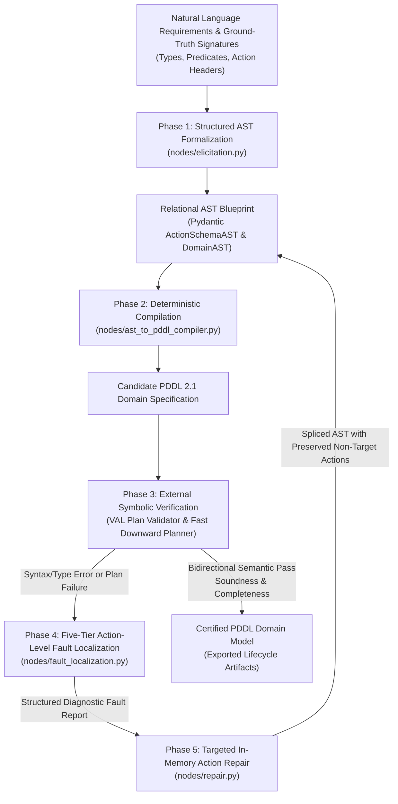

# Towards an Autonomous Lifecycle Agent for PDDL Domain Modelling

> **Master's Thesis Project**  
> **Author**: Roshan Gupta  
> **Supervisor**: Prof. Dr. Ilche Georgievski  
> **Institution**: Institute of Architecture of Application Systems (IAAS), University of Stuttgart  
> **Environment**: Conda `agent_env` (Python 3.10+)  
> **License**: MIT  

---

## 📌 Project Overview & Problem Statement

Constructing valid, robust **PDDL (Planning Domain Definition Language)** domain models for classical automated planning is a complex, iterative knowledge engineering process. Conventional approaches treat PDDL creation as an isolated, single-turn natural language translation task, which frequently leads to token-level syntax crashes, predicate arity mismatches, and unreachable state deadlocks. Furthermore, existing iterative repair approaches often re-prompt language models with raw, unparsed solver logs, causing cyclic repair oscillation and unintended modifications to already working actions.

This repository implements the **Autonomous PDDL Lifecycle Agent**, an autonomous, closed-loop neuro-symbolic framework for classical planning (strictly pure **PDDL 2.1 Level 1** with `:strips` and `:typing`).

### Defined Operational Scope
Importantly, the framework operates within an engineering setting with **predefined domain signatures** following standard action-model acquisition conventions:
* **Given Inputs**: Natural-language domain requirements alongside ground-truth object types ($\mathcal{T}_{\text{gold}}$), predicate signatures ($\mathcal{P}_{\text{gold}}$), and action parameter headers ($\mathcal{A}_{\text{sig}}$).
* **Autonomous Task**: Generating, verifying, localizing faults in, and surgically repairing **action preconditions and effects** ($\text{pre}(a)$ and $\text{eff}(a)$) without human intervention.
* **Verification Guarantee**: Non-circular semantic verification via **bidirectional plan validation** (Soundness and Completeness) evaluated exclusively against ground-truth planning problems using external symbolic oracles (**VAL** and **Fast Downward**).

---

## 🏗️ System Architecture & Lifecycle Stages

The agent is organized as a stateful cyclic computational graph (implemented with LangGraph) across five core functional stages:



### Detailed Lifecycle Phases

1. **Phase 1 — Structured AST Formalization (`nodes/elicitation.py`)**:
   Prompts a Large Language Model (LLM) to extract relational preconditions and add/delete effects into strongly typed Pydantic schemas (`ActionSchemaAST`), decoupling causal transition reasoning from surface syntax formatting.
2. **Phase 2 — Deterministic Algorithmic Compilation (`nodes/ast_to_pddl_compiler.py`)**:
   A deterministic Python compiler sorts type hierarchies under `object`, verifies variable scoping against action parameter declarations, aligns predicate signatures, prunes contradictory simultaneous effects ($p \land \neg p$), and serializes valid PDDL 2.1 domain specifications at zero additional LLM token cost.
3. **Phase 3 — External Symbolic Verification (`nodes/validation.py`)**:
   Evaluates candidate domains against reference planning problems using two certified symbolic tools:
   * **VAL (Plan Validation Tool)**: Simulates state transitions step by step to verify action applicability and goal attainment.
   * **Fast Downward (Classical Planner)**: Performs state-space search to check problem reachability and generate plan traces.
4. **Phase 4 — Five-Tier Action-Level Fault Localization (`nodes/fault_localization.py`)**:
   Decomposes oracle errors across five prioritized diagnostic tiers, isolating the responsible action schemas and offending literals:
   * **Tier 0 (Syntax & Typing Invariants)**: Predicate arity mismatches, undeclared parameter variables, and type inconsistencies (Compiler & VAL).
   * **Tier 1 (Initial-State Groundability)**: Action parameter types with empty object domains, or preconditions absent from `:init` and never added by any action.
   * **Tier 2 (Goal Reachability)**: Goal literals absent from `:init` with zero producer actions in the domain.
   * **Tier 3 (State-Transition Consistency)**: Contradictory simultaneous add/delete effects or missing transition deletes when moving entities.
   * **Tier 4 (Dynamic Plan Trace Analysis)**: Maps execution failures in candidate plans ($\pi_{\text{gen}}$) or reference plans ($\pi_{\text{gold}}$) back to lifted action schemas; falls back to static causal analysis when Fast Downward finds no plan.
5. **Phase 5 — Targeted In-Memory Action Repair (`nodes/repair.py`)**:
   Supplies counterexample-guided diagnostic reports to the LLM with surgical editing directives restricting modifications strictly to the localized actions. All other verified actions are deterministically restored from memory (`orig_action_map`), preventing prompt context expansion and secondary regressions.
6. **Bidirectional Semantic Verification Gate**:
   Ensures candidate models satisfy both:
   * **Soundness**: Plans found using the generated domain execute validly on the ground-truth domain ($\text{VAL}(D_{\text{gold}}, P_{\text{gold}}, \pi_{\text{gen}}) = \text{SUCCESS}$).
   * **Completeness**: Plans found using the ground-truth domain execute validly on the generated domain ($\text{VAL}(D_{\text{gen}}, P_{\text{gold}}, \pi_{\text{gold}}) = \text{SUCCESS}$).

---

## 🔬 Experimental Evaluation & Baselines

The framework is evaluated across two primary hypotheses and one descriptive research question:

* **Hypothesis H1 (Domain Formulation)**: Given ground-truth types, predicates, and action signatures, generating action schemas through a schema-validated AST and deterministic compiler achieves a significantly higher rate of satisfying both soundness and completeness criteria than single-pass raw PDDL generation (`ZERO_SHOT`) and iterative raw PDDL generation without structured AST enforcement (`ABLATION_NO_AST`). Evaluated using **McNemar's exact test**.
* **Hypothesis H2 (Domain Fault Repair)**: Layered action-level fault localization and targeted AST-based repair achieve a significantly higher repair success rate and require significantly fewer repair iterations than re-prompting with raw planner and validator error logs (`ABLATION_NO_TRIAGE`). Evaluated using **McNemar's exact test** for repair success and the **Wilcoxon signed-rank test** for repair iterations.
* **Research Question RQ3 (Resource Telemetry)**: Measures computational token overhead, wall-clock latencies, and iteration counts across all configurations.

### Evaluated Conditions

| Condition Code | Representation Modality | Feedback / Repair Mechanism | Statistical Role |
| :--- | :--- | :--- | :--- |
| **`CLOSED_LOOP_AST_AGENT`** | Schema-Validated AST | 5-Tier Fault Localization + Targeted In-Memory Repair | **Full Proposed Framework** |
| **`ABLATION_NO_AST`** | Direct Raw PDDL Text | Iterative repair loop without AST schema | Tests AST compilation impact (H1) |
| **`ABLATION_NO_TRIAGE`** | Schema-Validated AST | Re-prompting with raw unparsed validator/planner logs | Tests fault localization impact (H2) |
| **`ZERO_SHOT`** | Direct Raw PDDL Text | Single-pass generation without repair or feedback | Open-loop baseline (H1) |

### Benchmark Suites

1. **Formulation Suite (H1)**: 21 canonical classical planning domains from the International Planning Competition (IPC) and AutoPlanBench (`barman14-bfs`, `blocksworld`, `depot`, `driverlog02-bfs`, `elevators08`, `floortile`, `goldminer`, `gripper`, `logistics`, `nomystery11-bfs`, `parking11`, `pegsol08`, `pipesworld-notankage04-bfs`, `rovers`, `satellite`, `scanalyzer08`, `tpp06-bfs`, `transport08-bfs`, `visitall`, `woodworking08`, `zenotravel02`), evaluated across all ground-truth reference problems ($P_{\text{gold}} \in \Pi_{\text{ref}}$, 402 problem instances total).
2. **Domain Fault Repair Suite (H2)**: Curated single-action faulty domain tasks across the 21 benchmark domains (4 tasks per domain, plus 2 for `visitall`, yielding up to 84 curated flaw tasks):
   * *Operator 1 (41 tasks)*: Unsatisfiable precondition injection blocking forward reachability.
   * *Operator 2 (41 tasks)*: Critical goal add-effect deletion disconnecting causal graph reachability.
3. **Model Diversity**: Evaluated across proprietary frontier models (`openai/gpt-4o`) and open-weights code models (`deepseek/deepseek-chat`) ($R = 3$ independent runs per task, $k_{\max} = 3$, $T = 0.0$, failure penalty $P = 6$).

---

## 📊 Summary of Empirical Results

* **Formulation Benchmark (H1 - 21 Domains, Majority Voting $\ge 2/3$, $P=6$)**:
  * **GPT-4o (Full Agent)**: **57.1% majority success** (12/21 domains, 285/402 problems passed), 3.22 mean penalized iterations, 100.0% Syntactic Validity Rate (SVR).
  * **DeepSeek-Chat (Full Agent)**: **52.4% majority success** (11/21 domains, 259/402 problems passed), 3.30 mean penalized iterations, 95.2% SVR, with a 10.2x API cost reduction.
  * **Baselines**: Unstructured retry achieves 38.1% (GPT-4o) and 47.4% (DeepSeek-Chat); Zero-Shot single-pass collapses to 14.3% (GPT-4o) and 23.8% (DeepSeek-Chat) with up to 81.0% syntax crashes.
  * **McNemar Exact Tests**: Full Agent significantly outperforms `ABLATION_NO_AST` ($p = 0.00781$) and `ZERO_SHOT` ($p = 0.00391$ on GPT-4o, $p = 0.03125$ on DeepSeek-Chat).
* **Fault Repair Benchmark (H2 - 82 Tasks, $P=6$)**:
  * **GPT-4o (Full Agent)**: **68.3% repair success** (56/82 tasks), 2.72 mean iterations vs. 61.0% (50/82 tasks), 3.26 iterations under `ABLATION_NO_TRIAGE`.
  * **DeepSeek-Chat (Full Agent)**: **64.6% repair success** (53/82 tasks), 2.83 mean iterations vs. 51.2% (42/82 tasks), 3.51 iterations under `ABLATION_NO_TRIAGE` ($p = 0.01273$, statistically significant).
  * **Wilcoxon Signed-Rank Test**: The reduction in repair iterations achieved by the Full Agent is statistically significant across both foundation models ($p = 0.0383$ on GPT-4o, $p = 0.0068$ on DeepSeek-Chat).
* **Resource Telemetry (RQ3)**:
  * Formulation: mean 43,651 tokens, 68.77s latency per domain run.
  * Fault Repair: mean 35,267 tokens (GPT-4o) / 17,778 tokens (DeepSeek-Chat), 41.17s / 118.29s latency.

---

## 📂 Repository Directory Structure

```text
pddl_lifecycle_agent/
├── app.py                             # Interactive Streamlit UI application
├── graph.py                           # LangGraph state machine orchestrating closed-loop execution
├── run_h2_fault_repair_benchmark.py   # Category B 24-task fault repair benchmark runner
├── run_canonical_21_domains_benchmark.py # Multi-domain formulation and validation runner
├── requirements.txt                   # Python package dependencies
├── .env.example                       # Example configuration for API keys and oracle paths
│
├── nodes/                             # Implementation of the lifecycle agent nodes
│   ├── elicitation.py                 # Phase 1: Natural language extraction into typed AST
│   ├── ast_to_pddl_compiler.py        # Phase 2: Deterministic Python-to-PDDL 2.1 compiler
│   ├── validation.py                  # Phase 3: Symbolic oracle wrappers (VAL & Fast Downward)
│   ├── fault_localization.py          # Phase 4: Five-tier action-level fault localization
│   ├── repair.py                      # Phase 5: Targeted surgical in-memory AST repair
│   └── schemas/                       # Strongly typed Pydantic intermediate representations
│       ├── pddl_ast.py                # ActionSchemaAST and DomainAST schemas
│       └── pddl_standards.py          # Universal PDDL 2.1 semantic and syntax standards
│
├── eval/                              # Evaluation methodology, baselines, and statistics
│   ├── baselines.py                   # ZERO_SHOT, ABLATION_NO_AST, ABLATION_NO_TRIAGE runners
│   ├── statistical_significance.py    # McNemar's exact test & Wilcoxon signed-rank test
│   ├── metrics.py                     # Bidirectional Soundness & Completeness calculators
│   └── benchmark_runner.py            # Automated multi-task evaluation harness
│
├── benchmark/                         # Benchmark loaders and schemas
│   ├── loader.py                      # AutoPlanBench and IPC instance loaders
│   └── schema.py                      # Benchmark task metadata schemas
│
├── tools/                             # Symbolic planning executables and drivers
│   └── bin/
│       ├── VAL/                       # VAL 5.3 plan validation binaries (Validate.exe)
│       └── downward/                  # Fast Downward 24.06 planning system
│
├── results/                           # Centralized benchmark experiment outputs
│   ├── eval_artifacts/                # Exported PDDL domain files and plans from evaluation runs
│   ├── generated/                     # Elicited and repaired AST blueprints and PDDL files
│   └── *.csv                          # Evaluation summary tables and run logs
│
└── scientific-thesis-template-fresh/  # Master's Thesis LaTeX source document
    ├── main-english.tex               # Root LaTeX document (University of Stuttgart template)
    ├── abbreviations.tex              # Global glossary and abbreviation declarations
    ├── bibliography.bib               # Read-only BibTeX literature database
    ├── chapters-en/                   # Chapter source files (.tex and canonical .md)
    │   ├── 00 - abstract.md           # Master thesis abstract
    │   ├── 10 - introduction.tex      # Chapter 1: Introduction, MRQ, RQ1-3, H1-2
    │   ├── 20 - background.tex        # Chapter 2: Foundations & KE Lifecycle
    │   ├── 30 - problem exposition.tex# Chapter 3: Related Work & Positioning
    │   ├── 40 - first real chapter.tex# Chapter 4: Lifecycle Framework Architecture
    │   ├── 50 - second real chapter.tex# Chapter 5: Software Implementation Details
    │   ├── 60 - evaluation.tex        # Chapter 6: Empirical Evaluation & Validation
    │   └── 90 - conclusion.tex        # Chapter 7: Conclusion and Outlook
    └── scripts/                       # Automated thesis audit scripts
        ├── validate_latex.py          # Invariant validator (underscores, labels, cites)
        └── proofread_thesis.py        # University of Stuttgart v1.1 writing guideline audit
```

---

## 🛠️ Installation & Quick Start

### 1. Prerequisites
* **Operating System**: Windows 10/11, Linux (Ubuntu 20.04+), or macOS.
* **Conda Environment**: All scripts must be executed strictly within the Conda `agent_env` environment.
* **Symbolic Oracles**:
  * `tools/bin/VAL/Validate.exe` (Windows) or `validate` (Linux).
  * `tools/bin/downward/fast-downward.py` on system `PATH` or configured via `.env`.

### 2. Environment Setup
```powershell
# Activate target environment
conda activate agent_env

# Install dependencies
pip install -r requirements.txt
```

### 3. API Configuration
Create a `.env` file in the root directory:
```bash
# OpenRouter API Key
OPENROUTER_API_KEY=your_openrouter_api_key_here

# Model Assignment (temperature = 0.0)
LLM_MODEL=openai/gpt-4o

# Oracle Paths
VAL_PATH=tools/bin/VAL/Validate.exe
FAST_DOWNWARD_PATH=tools/bin/downward/fast-downward.py
FD_TIMEOUT_SEC=30
```

---

## 🚀 Running the Benchmarks & Interface

### 1. Interactive Streamlit Interface
Launch the interactive visual application to step through domain formalization, compilation, diagnostic triage, and repair:
```powershell
streamlit run app.py
```
Open `http://localhost:8501` to view the active LangGraph execution graph, AST schemas, compiler outputs, and VAL execution traces.

---

### 2. Domain Task Formulation Benchmark (Hypothesis H1)

The script `run_canonical_21_domains_benchmark.py` evaluates domain formulation from natural language requirements against ground-truth problem suites across 5 architectural conditions (`CLOSED_LOOP_AST_AGENT`, `ABLATION_NO_TRIAGE`, `ABLATION_NO_AST`, `UNSTRUCTURED_RETRY`, `ZERO_SHOT`).

#### A. Run a Single Domain
Evaluate a single domain (e.g., `floortile` or `blocksworld`):
```powershell
# Run a single domain across all 5 architectures (3 runs, max 3 repair iterations)
python run_canonical_21_domains_benchmark.py --domains floortile --runs 3 --max-retries 3

# Run a single domain exclusively on the Full Agent
python run_canonical_21_domains_benchmark.py --domains floortile --architectures CLOSED_LOOP_AST_AGENT --runs 3
```

#### B. Run Multiple Specific Domains
Evaluate a subset of domains by passing space-separated domain names:
```powershell
# Run a multi-domain subset across all architectures
python run_canonical_21_domains_benchmark.py --domains blocksworld gripper logistics depot --runs 3 --max-retries 3

# Run multiple domains on specific architectures
python run_canonical_21_domains_benchmark.py --domains blocksworld gripper logistics --architectures CLOSED_LOOP_AST_AGENT ABLATION_NO_AST ZERO_SHOT --runs 3
```

#### C. Run the Full 21-Domain Benchmark Suite
Execute the complete formulation evaluation across all 21 canonical IPC domains:
```powershell
# Full 21-domain benchmark across all 5 architectures (21 domains x 5 conditions x 3 runs = 315 executions)
python run_canonical_21_domains_benchmark.py --all-21 --runs 3 --max-retries 3

# Full 21-domain benchmark for the Full Agent only (21 domains x 3 runs = 63 executions)
python run_canonical_21_domains_benchmark.py --all-21 --architectures CLOSED_LOOP_AST_AGENT --runs 3 --max-retries 3
```

#### D. Custom Output CSVs and Resuming
The runner automatically saves progress after every run and resumes unfinished tasks:
```powershell
python run_canonical_21_domains_benchmark.py --domains floortile --output-csv results/my_h1_runs.csv --aggregated-csv results/my_h1_aggregated.csv
```

*Valid domain names*: `barman14-bfs`, `blocksworld`, `depot`, `driverlog02-bfs`, `elevators08`, `floortile`, `goldminer`, `gripper`, `logistics`, `nomystery11-bfs`, `parking11`, `pegsol08`, `pipesworld-notankage04-bfs`, `rovers`, `satellite`, `scanalyzer08`, `tpp06-bfs`, `transport08-bfs`, `visitall`, `woodworking08`, `zenotravel02`.

---

### 3. Domain Fault Repair Benchmark (Hypothesis H2)

The script `run_h2_fault_repair_benchmark.py` evaluates five-tier causal fault localization against raw error re-prompting (`CLOSED_LOOP_AST_AGENT` vs. `ABLATION_NO_TRIAGE`) across curated single-action faulty domain tasks.

#### A. Run a Single Domain
Evaluate all fault repair tasks for a specific domain (e.g., `floortile`):
```powershell
# Run all curated flaw tasks for floortile (4 tasks x 2 architectures = 8 executions)
python run_h2_fault_repair_benchmark.py --domains floortile --max-iters 3
```

#### B. Run Multiple Specific Domains
Evaluate fault repair across several target domains:
```powershell
# Run flaw repair for blocksworld, gripper, and logistics
python run_h2_fault_repair_benchmark.py --domains blocksworld gripper logistics --max-iters 3
```

#### C. Run the Full Benchmark Suite (All 21 Domains / 82-84 Tasks)
Run the comprehensive fault repair benchmark across the entire benchmark suite:
```powershell
# Full curated flaw suite (84 tasks x 2 architectures = 168 executions)
python run_h2_fault_repair_benchmark.py --max-iters 3

# With custom destination files
python run_h2_fault_repair_benchmark.py --output-csv results/h2_evaluation_runs.csv --summary-json results/h2_evaluation_summary.json --max-iters 3
```

#### D. Quick Smoke Test (Task Limit)
To run a quick sanity check without running the full suite:
```powershell
# Run only the first 4 tasks from the manifest
python run_h2_fault_repair_benchmark.py --limit 4 --max-iters 3
```
*Note: Both H1 and H2 benchmark runners feature automatic checkpointing and state persistence in CSV format. If a run is interrupted, re-running the exact same command automatically skips already completed runs.*

---

### 4. Switching Foundation Models

Select the target language model by updating `.env` or setting the environment variable:
```powershell
# Using GPT-4o
$env:LLM_MODEL="openai/gpt-4o"

# Using DeepSeek-Chat
$env:LLM_MODEL="deepseek/deepseek-chat"
```

---

### 5. LaTeX Thesis Pre-Flight Audit Scripts
To verify the Master's Thesis document invariants and ensure 100% adherence to University of Stuttgart writing guidelines (Dr. Ilche Georgievski & Prof. Dr. Marco Aiello, v1.1):
```powershell
# Verify syntax, underscore escaping, citations, and labels
python scientific-thesis-template-fresh/scripts/validate_latex.py

# Verify writing guidelines (no contractions, no "This" openings, acronym protocol)
python scientific-thesis-template-fresh/scripts/proofread_thesis.py
```

---

## 📄 License & Academic Attribution

This project is licensed under the **MIT License**.

If you use this framework or benchmark suite in your research, please cite:
```bibtex
@mastersthesis{gupta2026pddllifecycle,
  author       = {Roshan Gupta},
  title        = {Towards an Autonomous Lifecycle Agent for PDDL Domain Modelling},
  school       = {Institute of Architecture of Application Systems (IAAS), University of Stuttgart},
  year         = {2026},
  supervisor   = {Prof. Dr. Ilche Georgievski}
}
```
